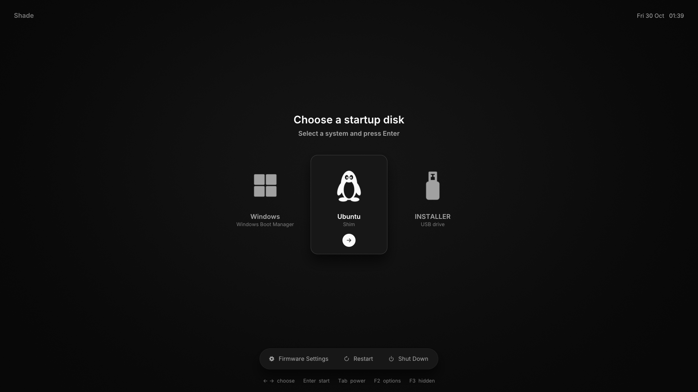
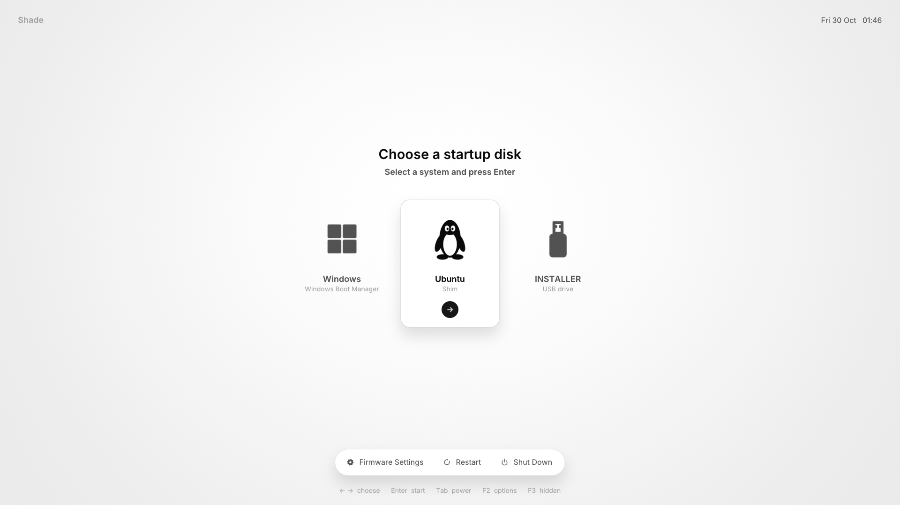
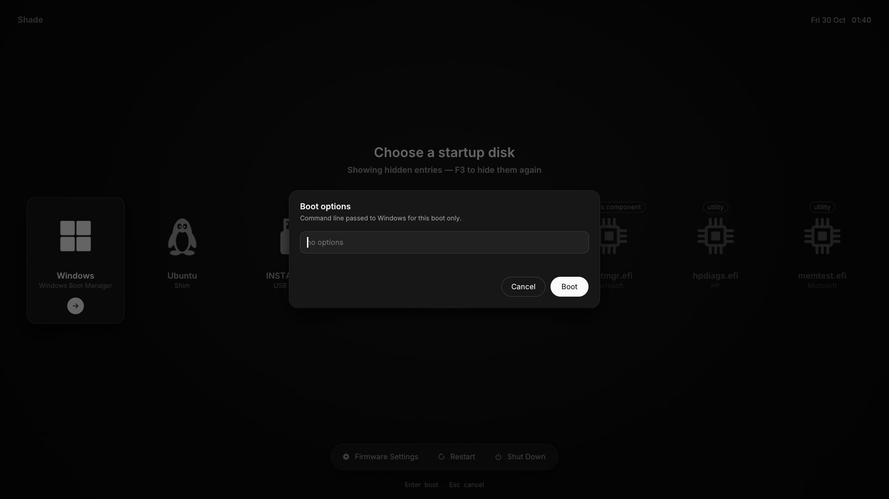

# Shade

A modern, themeable UEFI boot picker in the spirit of the macOS Startup
Manager. It shows **only what you'd actually boot** and gets out of the way
quickly.



- **A short list.** One tile per operating system (Windows, each Linux
  distro, macOS) plus one per other bootable drive (USB installers and the
  like). MokManager, fallback copies, GRUB-behind-shim, OEM diagnostics, EFI
  shells and PXE/HTTP firmware entries are hidden. Press **F3** to see them.
- **Ignore list.** Keep a games or data drive out entirely by label, partition
  GUID, path or title. An ignored volume isn't even scanned.
- **Smooth.** The selection card glides on a critically-damped spring, the
  screen enters on a decelerate curve and exits on an accelerate one. Text is
  anti-aliased Inter with subpixel positioning.
- **Efficient.** Each screen region redraws only when its state changes, so a
  static screen costs nothing and an animation only touches the area that moves.
- **Themeable.** Palette, shape, type, layout, shadow, motion, icons and
  wallpaper all come from a small `theme.conf` (see [docs/THEMING.md](docs/THEMING.md)).
- **Responsive.** The layout scales with resolution (1× up to 3×), the row
  scrolls when there are many entries, and it works with keyboard or mouse.
- **No dependencies.** Freestanding C with its own UEFI headers, built with
  clang + lld. The fonts and default theme are embedded in one ~1 MB `.efi`.

| Daylight theme | Boot options (F2) + hidden entries (F3) |
|---|---|
|  |  |

## Keys

| Key | Action |
|-----|--------|
| ← → / 1–9 / Home / End | choose |
| Enter / Space / click | start |
| Tab / Shift+Tab | move focus: tiles → Firmware Settings → Restart → Shut Down → tiles |
| ↓ / ↑ | jump to the power buttons / back to the tiles |
| F2 / e | edit the load options (kernel command line) for this boot |
| F3 | show / hide hidden entries |
| Esc | close hidden entries / the options sheet |

Nothing boots until you choose. To auto-boot the default after N seconds,
set `timeout = N` in `shade.conf`; any input then cancels the countdown.

## Build and try it

```sh
make            # build/BOOTX64.EFI
make test       # host unit tests for entry filtering + config parsing
make run        # QEMU + OVMF with test disks: Windows, Ubuntu, a USB
                # installer and an ignored "GAMES" drive, plus clutter
```

`make run` opens a native QEMU window (GTK, scaled to fit, so tiling window
managers are fine). The devcontainer reaches your desktop through the X
display VS Code forwards. Without a GUI-capable QEMU it falls back to the
browser via noVNC (`make run-browser`). The test "OS loaders" are stand-ins:
picking one shows its path, and any key returns to Shade.

`make run-headless` exposes a monitor socket; `tools/qemu-ctl.py` can take
screenshots and send keys (that's how the screenshots above were made).

The devcontainer has the full toolchain, plus the GitHub CLI and Claude Code,
whose logins persist in named volumes across rebuilds.

### Without the container

You don't need Docker. Shade builds with ordinary packages; install them,
then use the same `make`, `make test` and `make run` as above.

| What | Why |
|------|-----|
| clang, lld, make | build the `.efi` (lld provides `lld-link`) |
| python3 | embeds fonts/theme, builds the test disks (standard library only) |
| mtools, dosfstools | FAT test disks for `make run` |
| qemu (x86_64, with a GUI) + OVMF | `make run` (only needed to try it in a VM) |
| gcc | `make test` (host tests run under AddressSanitizer) |
| efibootmgr | `tools/install.sh` on a real machine |

**Arch / Manjaro / EndeavourOS**

```sh
sudo pacman -S --needed clang lld make python mtools dosfstools qemu-desktop edk2-ovmf gcc efibootmgr
```

**Debian / Ubuntu / Pop!_OS / Mint**

```sh
sudo apt install clang lld make python3 mtools dosfstools qemu-system-x86 qemu-system-gui ovmf gcc efibootmgr
```

**Fedora**

```sh
sudo dnf install clang lld make python3 mtools dosfstools qemu-system-x86 qemu-ui-gtk edk2-ovmf gcc libasan libubsan efibootmgr
```

**macOS** (Homebrew; Apple's clang can't link EFI binaries, so use Homebrew's LLVM)

```sh
brew install llvm lld make python mtools dosfstools qemu
gmake CC="$(brew --prefix llvm)/bin/clang"      # likewise: gmake run CC=...
```

`make run` opens a Cocoa window there. Intel Macs use HVF acceleration; Apple
Silicon emulates x86, so it's slower but works. `tools/install.sh` is
Linux-only.

**Windows**: use WSL2 with Ubuntu and follow the Debian/Ubuntu line. WSLg
shows the QEMU window on your desktop. To install Shade on the real machine,
copy `build/BOOTX64.EFI` and `themes/` to the ESP yourself (see Install), as
`install.sh` can't register boot entries from inside WSL.

Notes:

- `make run` uses KVM (Linux) or HVF (Intel Mac) when available and falls
  back to plain emulation otherwise, which works but animates slowly.
- The Makefile finds OVMF in the usual places for each distro. If yours is
  elsewhere: `make run OVMF_CODE=/path/OVMF_CODE.fd OVMF_VARS=/path/OVMF_VARS.fd`.
- If your QEMU has no window support, `make run-browser` shows the VM in a
  browser instead (needs `novnc`).

## Install

```sh
make
sudo tools/install.sh              # or: tools/install.sh --dry-run to see what it would do
```

This copies Shade to `\EFI\shade\shadex64.efi` with the themes and a default
`shade.conf`, and registers a firmware boot entry. Shade is unsigned: with
Secure Boot on, sign it with your own key (`sbsign`) or enroll it through
shim/MOK.

## Configuration

`\EFI\shade\shade.conf`, fully commented in [config/shade.conf](config/shade.conf):

```ini
timeout = -1            # manual (default); N = auto-boot after N seconds
default = last          # or a title, e.g. Windows
theme   = neutral

[ignore]
volume = Games          # my games drive never shows up

[options]
Linux = root=UUID=<your-root-uuid> rw quiet    # see: findmnt -no UUID /
```

## Layout

```
include/efi.h        minimal UEFI definitions
src/core/            libc shim, firmware helpers, strings, INI parser, log
src/gfx/             canvas, AA primitives, shadows, images, fonts, display
src/anim/            easing curves, tweens, spring
src/input/           keyboard + relative/absolute pointer
src/boot/            discovery (firmware), filter (pure C, unit tested), loader
src/theme/           theme loading and icon lookup
src/ui/              the picker
themes/              neutral (default, embedded) and daylight
```

## License

MIT. Inter is licensed under the SIL Open Font License
(`third_party/inter/OFL.txt`); stb_truetype and stb_image are public domain.
